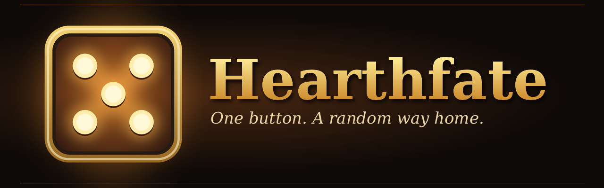
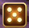
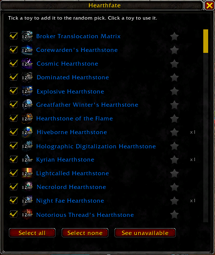
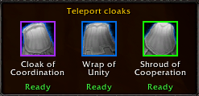
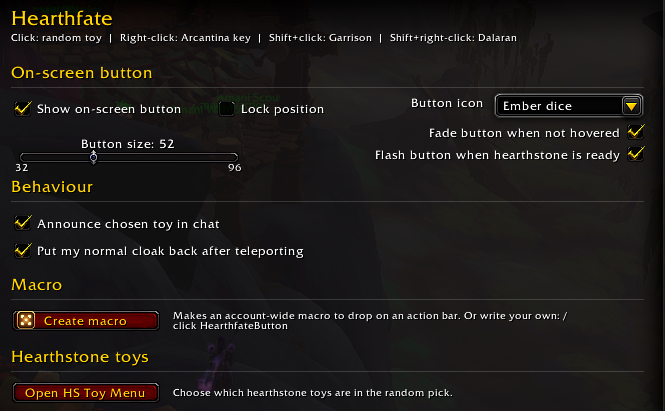

# Hearthfate

One button, one random hearthstone. Hearthfate sends you home with a random toy from the hearthstones you choose, with a cooldown display and quick shortcuts for the rest of your travel toys.



## Features

- **Random hearthstone button.** Click it to use a random hearthstone toy from your pool. It never picks the same toy twice in a row, and starred favourites come up more often.
- **Pick your pool.** The toy menu lists every hearthstone toy you own. Tick the ones you want in the random pick, or click a toy to use it straight away.
- **Cooldown and charges.** A cooldown swirl on the button, plus the charge count for characters with an extra hearthstone charge.
- **Travel shortcuts.** One click for your other travel toys:
  - Right-click: Personal Key to the Arcantina
  - Shift+click: Garrison Hearthstone
  - Shift+right-click: Dalaran Hearthstone
- **Teleport cloaks.** Ctrl+click opens a bar with the teleport cloaks you own (Cloak of Coordination, Wrap of Unity, Shroud of Cooperation). Your normal cloak can be put back for you after you teleport.
- **See what you're missing.** The "See unavailable" view in the toy menu lists the hearthstone toys you don't own yet. Shift+click one to copy its Wowhead link.
- **Make it yours.** Four button icons, resizable and movable, an option to fade the button when you're not hovering over it, and a pulse when your hearthstone is ready again.





## Using it

| Action | What it does |
| --- | --- |
| Click | Use a random hearthstone toy |
| Right-click | Personal Key to the Arcantina |
| Shift+click | Garrison Hearthstone |
| Shift+right-click | Dalaran Hearthstone |
| Ctrl+click | Open the teleport cloak bar |
| Alt+click | Open the toy menu |
| Shift+drag | Move the button (when not locked) |

You can also bind a key to it in the game's Key Bindings window, under AddOns, or make a macro from the options panel (or type this yourself):

```
/click HearthfateButton
```

## Slash commands

| Command | What it does |
| --- | --- |
| `/hfate` | Show the version and a short reminder |
| `/hfate menu` | Open the toy menu |
| `/hfate options` | Open the options panel |
| `/hfate list` | List the hearthstone toys you own |
| `/hfate resetcount` | Reset the use counts shown in the toy menu |



## Notes

- Made for the current retail game (Midnight). Toys are always listed from your own collection.
- The list of hearthstone toys is kept up to date by hand, so toys added in a new patch may need an addon update to appear.
- Hearthfate only uses toys and items through the game's normal secure actions. It does not do anything in combat that the game doesn't already allow.

## License

[MIT](LICENSE) © 2026 ContraZoom